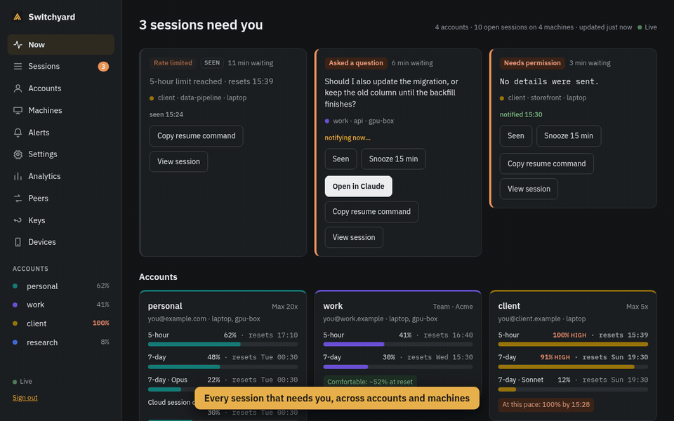
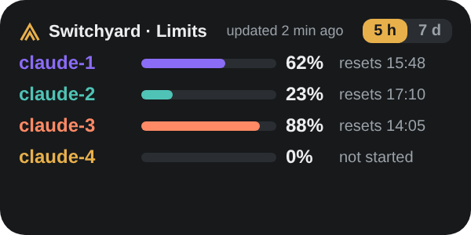
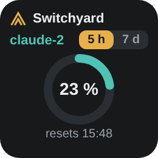
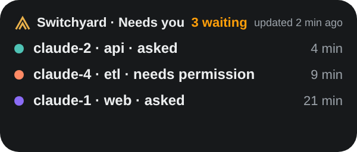
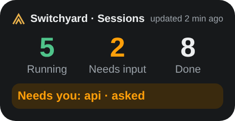
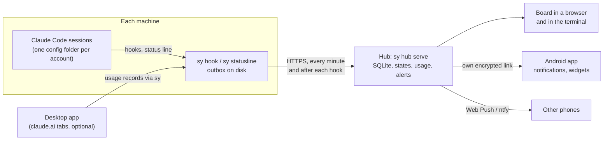

# Switchyard

[](https://github.com/mraj602/switchyard/actions/workflows/ci.yml)
[](https://github.com/mraj602/switchyard/actions/workflows/app.yml)
[](https://github.com/mraj602/switchyard/actions/workflows/phone.yml)
[](LICENSE)

A self-hosted board for several Claude Code accounts on several machines: every session's
state, every account's limits, and a notification when a session needs you.

**Website: <https://mraj602.github.io/switchyard/>**

> **Unofficial.** Switchyard is an independent community project. It is not affiliated with,
> endorsed by, sponsored by or connected to Anthropic. "Claude" and "Claude Code" are
> trademarks of Anthropic, PBC, used here only to describe compatibility. Use it only with
> your own accounts and within the terms of your plan. See [Terms and risk](#terms-and-risk).

If you run Claude Code in two or more accounts (say work and personal), on a laptop and a
server or two, you end up checking terminals to see which session is waiting for you and
which account still has room. Switchyard gives you one view of all of it, on your own hub:

- **One board** of every session on every machine, grouped by account: working, needs
  permission, asked a question, done, failed.
- **Every account's limits** (5-hour, 7-day, per model) with reset times and history.
- **Alerts** when a session needs you, on an Android app with its own connection to your hub
  (no Google push service and no proprietary Google code), as Web Push, through ntfy or as
  desktop notifications.
- **Account setup and sharing:** one command labels your Claude Code config folders and makes
  them share settings, skills, plugins and MCP servers. Logins are never touched.
- **Peers:** Claude Code sessions in your different accounts and machines can message each
  other, gated by a matrix you sign with your own key. The hub relays ciphertext only.

## Screenshots



Recorded from the mock hub with sample data (`scripts/demo/record.cjs`).

Android home-screen widgets (rendered previews from the app):

<p>
  
  
</p>
<p>
  
  
</p>

## How it works



- `sy` is one static Go binary. Claude Code runs it from hooks and the status line; it
  appends one record per event to a local outbox and exits. Nothing stays running except an
  optional per-machine agent for peers.
- Records go to the hub over HTTPS (or loopback, or your tailnet). If the hub is away they
  wait in the outbox and are sent later without duplicates.
- The hub is the same binary (`sy hub serve`) with one SQLite file. It works out session
  states and usage windows, sends alerts and serves the board. It never talks to Anthropic and
  never holds a Claude login.

More: [ARCHITECTURE.md](ARCHITECTURE.md).

## Quickstart

Needs Claude Code, on Linux or macOS. This runs the hub on the same computer:

```sh
curl -fsSL https://github.com/mraj602/switchyard/releases/latest/download/install.sh | sh
sy setup            # shows a plan first; choose "Just this computer" for the hub
sy hub owner-link   # open the printed link: the board, signed in as the owner
```

The script puts one file, `sy`, in `~/.local/bin`, after checking its SHA-256 against the
release's `SHA256SUMS`. It edits no shell profile and no PATH: if `~/.local/bin` is not on
your `PATH`, it prints the line to add. It then starts `sy setup` when a terminal is
available (`--no-setup` skips that). On Windows, see [Releases](#releases).

**Build from source instead.** This needs Go 1.27+, `make` and `git`:

```sh
git clone https://github.com/mraj602/switchyard.git && cd switchyard
make build && install -D -m 0755 dist/sy ~/.local/bin/sy
```

Then run `sy setup` as above.

Restart your open Claude Code sessions afterwards so they load the plugin. Everything
`sy setup` changes is backed up; `sy setup --undo` reverses it. Next steps: a hub on a server,
more machines, the phone: [docs/guide/install.md](docs/guide/install.md).

## Components

| Component | What it is | Platforms | Docs |
| --- | --- | --- | --- |
| `sy` | The CLI on every machine: setup, hooks, status line, outbox, terminal board, peers | Linux, macOS; Windows with gaps (no peers or owner key) | [install](docs/guide/install.md), [accounts](docs/guide/accounts.md) |
| Hub | `sy hub serve`: storage, states, usage, alerts, the web board. Docker, systemd or a user service | Linux, macOS | [install](docs/guide/install.md#2-choose-where-the-hub-runs), [deploy/](deploy/README.md) |
| Board | The hub's web UI; installs on a phone as a web app; also `sy board` in a terminal and a pane inside Claude Code | Any modern browser | [board](docs/guide/board.md) |
| Desktop app | One tab per claude.ai account, a usage strip per account, the board in a Hub view | Linux, macOS, Windows | [desktop](docs/guide/desktop.md) |
| Android app | The board's screens, native notifications with Open, Snooze and Seen, six widgets | Android 12+ | [android](docs/guide/android.md) |
| Claude Code plugin | Hooks that run `sy hook`, skills for setup, status, accounts and peers | Claude Code | [board](docs/guide/board.md#claude-code-plugin-from-github) |

## Documentation

- [User guide](docs/guide/README.md): install, accounts and sharing, the board, desktop app,
  Android app, alerts, usage limits, peers and the owner key, how Switchyard talks to
  claude.ai, security and privacy,
  maintenance, troubleshooting, uninstall, FAQ.
- [ARCHITECTURE.md](ARCHITECTURE.md): components, data flow, storage, security boundaries,
  repository layout.
- [docs/spec/](docs/spec/README.md): the behaviour specs (records, API, schema, states,
  setup, push, keys, peers, and more). They are the source of truth.
- [CONTRIBUTING.md](CONTRIBUTING.md), [SECURITY.md](SECURITY.md), [CHANGELOG.md](CHANGELOG.md).

## Releases

Releases are on [GitHub Releases](https://github.com/mraj602/switchyard/releases). A tag
`vX.Y.Z` publishes:

- `sy` archives for Linux, macOS and Windows (amd64 and arm64), with `SHA256SUMS`, and the
  install scripts `install.sh` and `install.ps1`;
- the desktop app packages (AppImage, deb, rpm, dmg and the Windows installer), with
  `SHA256SUMS-desktop`;
- GitHub build-provenance attestations for every archive and package.

The Android APK is a separate release, `phone-vX.Y.Z`. The maintainer signs it with their own
key, and the certificate fingerprint is in that release's note
([Android guide](docs/guide/android.md#verify-the-apk)).

Install `sy` on Linux or macOS with the one-liner in the [Quickstart](#quickstart). Add
`sh -s -- --version 0.9.0` to pick a version. On Windows, in PowerShell 5.1 or later:

```powershell
irm https://github.com/mraj602/switchyard/releases/latest/download/install.ps1 | iex
```

That puts `sy.exe` in `%USERPROFILE%\.local\bin`, after the same checksum check. To pass
options such as `-Version` or `-NoSetup`, run it as a script block, as the header of
[install/install.ps1](install/install.ps1) shows.

To check where a file came from, run `gh attestation verify <file> --repo mraj602/switchyard`.
Or set `SY_VERIFY_ATTESTATION=1` and the install script does it for you (it needs the `gh`
CLI). `sy update` keeps `sy` current ([maintenance](docs/guide/maintenance.md#sy-update)). The
desktop app and the Android app update as their guides describe.

## FAQ

**Does the hub see my claude.ai cookies, prompts or code?** No. Sign-ins stay in local
browser sessions on your devices, and the hub never receives cookies, tokens, prompts, code
or tool output. By default it receives the tail of Claude's last message in a turn, for
question detection; `sy config set privacy.last_message false` turns that off.
[Security and privacy](docs/guide/security.md).

**Do I need a server or Tailscale?** No. The hub can run on your laptop. A server keeps alerts
working while the laptop sleeps; Tailscale or a reverse proxy gives your phone an `https://`
address.

**Is there an iPhone app?** No, Android only. On an iPhone, install the board as a web app
(iOS 16.4+ for notifications) or use ntfy.

**Does it switch accounts when one hits a limit?** No, never. It shows which account has room;
you choose.

More: [docs/guide/faq.md](docs/guide/faq.md).

## Similar tools

I could not find one tool that covers many accounts across many machines with session states,
alerts and peer messaging, but several good tools cover parts of it, and one of them may be all
you need:

| Tool | Focus | Compared with Switchyard |
| --- | --- | --- |
| [ccusage](https://github.com/ccusage/ccusage) | Usage reports from local Claude Code logs | Switchyard also records the official limit percentages per account, across machines, with alerts |
| [Claude-Code-Usage-Monitor](https://github.com/Maciek-roboblog/Claude-Code-Usage-Monitor) | Live terminal usage monitor with predictions | One account and machine; Switchyard adds a hub, session states and a phone |
| [claude-squad](https://github.com/smtg-ai/claude-squad) | Manage several agent sessions in one terminal | Runs sessions locally; Switchyard observes the sessions you already run, in many accounts |
| [CloudCLI / claudecodeui](https://github.com/siteboon/claudecodeui) | Web and mobile UI to drive Claude Code | Drives sessions; Switchyard tracks state and alerts across accounts and machines |
| [vibe-kanban](https://github.com/BloopAI/vibe-kanban) | A board that runs and orchestrates coding agents | Orchestration; Switchyard does not start or steer agents |
| [ccstatusline](https://github.com/sirmalloc/ccstatusline), [claude-hud](https://github.com/jarrodwatts/claude-hud) | Rich in-session status lines | Per session; Switchyard is the cross-session view (and wraps your status line) |
| [claude-swap](https://github.com/realiti4/claude-swap) | Switch between Claude Code accounts | Switchyard keeps all accounts side by side and never switches or rotates for you |

## Terms and risk

- Switchyard is unofficial and not affiliated with Anthropic.
- Its Claude Code integration uses documented extension points: hooks, the status line,
  plugins and `CLAUDE_CONFIG_DIR`. Logging in is always Claude Code's own `claude auth login`.
- The account tabs in the desktop app (and in the Android app) load claude.ai's own pages.
  You sign in on Anthropic's page; the sign-in stays in a local browser session on that
  device. Switchyard never reads, exports or sends cookies or tokens, and nothing from a tab
  reaches the hub.
- The desktop app's account tabs send a plain Chrome user agent, because claude.ai's bot
  protection rejects Electron's default one. claude.ai sees an ordinary Chrome browser.
- **Usage reading in the desktop app uses claude.ai's undocumented endpoints.** A script in
  each signed-in tab reads the same numbers as claude.ai's Settings → Usage page every 5
  minutes. It is off for each account until you accept a warning, it stops on errors such as
  401, 403 and 429, and it is not an official API, so it may break at any time. Anthropic's
  consumer terms restrict automated access, so it could go against the spirit of the terms
  and get an account flagged; you decide whether to turn it on.

Every place Switchyard talks to claude.ai, and how to turn each off:
[Privacy, risks and how Switchyard talks to claude.ai](docs/guide/claude-ai.md).

- Use your own accounts, each within the terms of its plan
  ([Consumer Terms](https://www.anthropic.com/legal/consumer-terms),
  [Usage Policy](https://www.anthropic.com/legal/aup)). Do not share accounts or credentials.
  Advertised plan limits assume ordinary, individual use.
- Switchyard never switches or rotates accounts to get around limits. "Most room right now"
  is a suggestion; you choose.
- Peers is for your own sessions in your own accounts, not for pooling accounts between people.

## Contributing

Contributions are welcome: read [CONTRIBUTING.md](CONTRIBUTING.md). Behaviour changes start in
[docs/spec/](docs/spec/README.md). Commits are signed off under the
[Developer Certificate of Origin](https://developercertificate.org/). Please follow the
[Code of Conduct](CODE_OF_CONDUCT.md), and report security problems privately
([SECURITY.md](SECURITY.md)).

## License

Apache License 2.0: see [LICENSE](LICENSE) and [NOTICE](NOTICE). The license grants no rights
to the Switchyard name or to any Anthropic trademark.

---

Switchyard is an independent, unofficial project, not affiliated with, endorsed by or
sponsored by Anthropic. "Claude" and "Claude Code" are trademarks of Anthropic, PBC.
