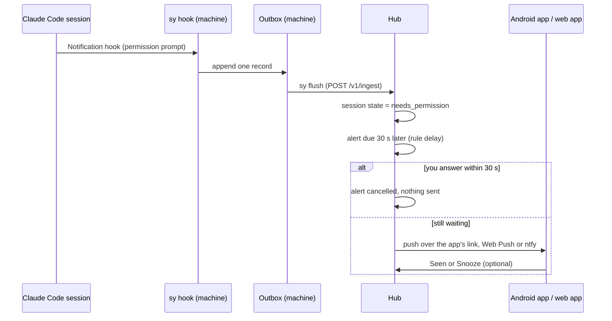

# Alerts and notifications

The hub decides when something deserves your attention and sends it to every place you set
up: the Android app, the web app (Web Push), ntfy and the desktop app. This guide covers what
fires an alert, where it goes and how to tune it. The full rules are in
[push.md](../spec/push.md).

## How an alert travels



1. Claude Code runs the Switchyard plugin's hook on each event. `sy hook` writes one record to
   the local outbox and returns at once; it never blocks or answers for you.
2. `sy flush` sends the outbox to the hub (right after the hook, and every minute from the
   timer).
3. The hub folds the records into each session's state. When a session enters a state that
   needs you, the hub creates one alert for that episode, due after the rule's delay.
4. If the state changes before the alert is due (you answered), the alert is cancelled.
   Otherwise it is sent to every enabled target whose device has not muted that trigger.

Each episode alerts at most once, so restarts and replays never send duplicates.

## Triggers and default rules

| Trigger | When | Default |
| --- | --- | --- |
| `needs_permission` | A session waits on a permission prompt | On, after 30 s |
| `asked` | A session asked a question, opened a dialog or has a plan ready | On, after 60 s |
| `failed` | A turn stopped with an error (rate limit, login, billing) | On, at once, goes through quiet hours |
| `limit_80` | An account's 5-hour or 7-day window reached 80 % | On, at once |
| `limit_95` | The same window reached 95 % | On, at once |
| `reset` | A window that passed 80 % has reset | Off |
| `machine_silent` | A machine with live sessions sent nothing for an hour | On |

"Turn finished" is not an alert: the board shows it. Limit alerts use the highest value a
window reached, so a window that dips back under 80 % does not alert again. See
[usage.md](usage.md) for where limit numbers come from.

## Changing the rules

Rules are global and belong to the owner. Open the board signed in as owner
(`sy hub owner-link` on the hub prints a one-time sign-in link), then **Alerts**:

1. Each trigger has a switch and a delay. Change them in place.
2. Add an override to treat one account, project or machine differently (for example: no
   `asked` alerts for project `scratch`, or a 5-minute delay for one account).
3. Under the list, **Recent pushes** shows every alert with its outcome: pushed, seen,
   snoozed or cancelled. Cancelled means you answered before it was due.

A phone cannot change global rules. Its own Alerts screen has a switch per trigger that mutes
that trigger on that phone only.

## Channels

| Channel | Who reads the text | Set up in |
| --- | --- | --- |
| Android app (its own link to the hub) | Only the app: sealed to a key on the phone | [android.md](android.md) |
| Web Push (the web app on a phone or desktop browser) | Only the subscribed browser; the push service sees ciphertext | Below |
| ntfy | Your ntfy server, or ntfy.sh and anyone who knows the topic | Below |
| Desktop app | Local OS notifications from the hub's live stream | [desktop.md](desktop.md) |

The hub sends Web Push and ntfy as outbound HTTPS requests; no inbound port is needed for
pushes. The Android app uses no push service at all.

### Web Push (the web app)

The board installs as a web app on a phone. This is also the way to get notifications on an
iPhone, since there is no native iOS app.

1. Give the hub an `https://` address (see [install.md](install.md)); browsers allow push
   only in a secure context.
2. On the hub: `sy phone pair --url https://laptop.example.ts.net`. It prints a QR and a
   6-digit code.
3. Scan the QR with the phone's camera.
   - Android (Chrome): the page offers **Install app**.
   - iPhone or iPad (iOS 16.4 or later): Safari, Share, **Add to Home Screen**, then open the
     installed app and enter the code. Notifications work only in the installed app.
4. In the web app: Settings, **Turn on notifications**, then **Send test push**.

On iOS the notification has no action buttons; Snooze and Seen are inside the app.

### ntfy

ntfy suits machines and phones where you already use the ntfy app.

1. Signed in as owner, open Settings on the board and add an ntfy target. Leave the topic
   empty and the hub makes a long random one (`sy-` and 24 characters).
2. Subscribe to that server and topic in the ntfy app.
3. Set the hub's public URL first; without it ntfy alerts have no link and no Snooze or Seen
   buttons.

On ntfy.sh, topics are public: anyone who learns the name can read the messages. For that
reason **private pushes are on by default for ntfy.sh targets** (see below). A self-hosted
ntfy server avoids this.

## Snooze, Seen and batching

- **Seen** marks the alert read on every device. It does not answer the session.
- **Snooze** re-sends the alert after 15 minutes (the owner can set 5 to 240 minutes) if the
  session still needs you. The re-push starts with "Still waiting".
- Session alerts due within 2 seconds of each other go out as one push ("3 sessions need
  you").
- A flood cap allows at most 6 pushes per target per 10 minutes; the rest are merged into one
  summary.
- An alert that would arrive more than 15 minutes late (a laptop that slept, records flushed
  hours later) is not pushed. The board still shows the session.

## Quiet hours

Quiet hours hold every push except `failed` and send one summary when they end ("While you
were away: 2 sessions still need you"). Set them for the whole hub on the board (Alerts,
owner), or per device in that device's Settings. A device can also ask for true silence, which
holds `failed` too.

## Private pushes

With private pushes on, the lock screen shows only "Switchyard" and "1 session needs you",
"An account is near its limit" and similar. No project, account or session name appears in
the text or the link; the details load when you open the app. Turn it on per device in
Settings, or as the hub default (owner).

What a non-private push contains: the account label, the project folder name, the trigger and,
when last messages are allowed, the question Claude asked (cut short). See
[security.md](security.md) for what the hub stores.

## Direct push from a machine

A server that cannot reach the hub (the hub is on a laptop that sleeps, or the server is only
reachable over SSH) can send ntfy pushes itself when a session needs you and the hub has not
heard from it.

```sh
sy direct-push on --server https://ntfy.sh --after 2m --secret-stdin
# stdin: {"topic": "sy-...", "token": "tk_..."}   (token optional)
sy direct-push test        # sends a test message
sy direct-push status
sy direct-push off
```

Use the same topic as a hub ntfy target so your phone already listens. The topic is read from
stdin (or prompted at a terminal) and stored in the state folder with mode 0600; it never goes
on the command line. When the hub catches up it sees that the push was already sent and does
not repeat it. Only ntfy works this way: Web Push and the Android link need keys that stay on
the hub. Details: [machines.md, section 5](../spec/machines.md#5-direct-ntfy-from-sy).

## Checking delivery

- The board's **Alerts** page lists recent pushes and their outcome per target.
- `sy doctor` on the hub checks the public URL, the Web Push keys, that at least one device
  can receive pushes, and the last delivery error.
- On Android, Settings, Notifications shows the link state; see [android.md](android.md).
- More in [troubleshooting.md](troubleshooting.md).
