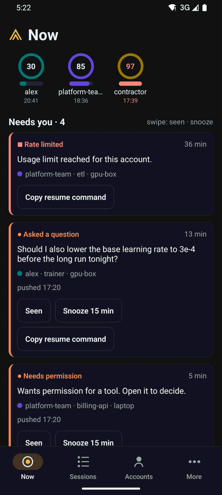
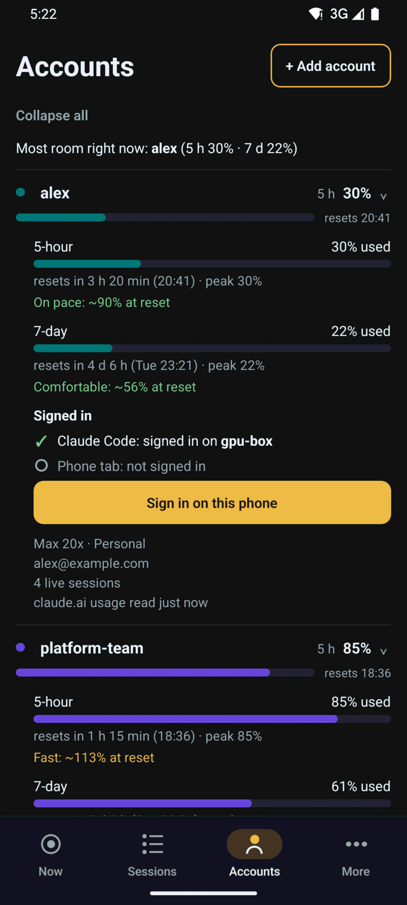
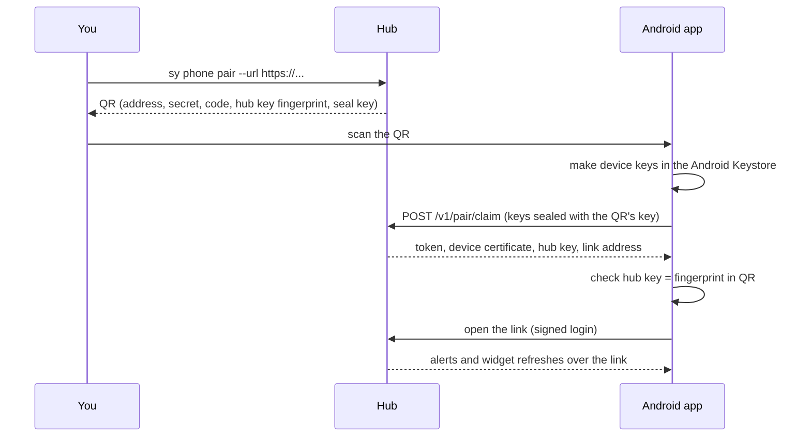

# Android app

The Android app shows the hub's screens (Now, Sessions, Accounts, More), posts native
notifications with **Open**, **Snooze** and **Seen**, and adds home-screen widgets. It is a
`phone` device on your hub: it can read and snooze or mark alerts seen, nothing else. The
spec is [phone.md](../spec/phone.md); notifications over the app's link are
[push.md, sections 13 and 14](../spec/push.md#13-the-link-channel).

Requirements: Android 12 or later (minimum SDK 31), and a hub with an `https://` address.
There is no iOS app; on an iPhone use the web app (see [alerts.md](alerts.md#web-push-the-web-app)).

<p>
  
  
</p>

## No push service

The app keeps its own encrypted connection to your hub (the link) and posts notifications
itself. There is no Google push, no Firebase project, no Google Play services, no Expo account
and no store listing.
The hub needs no outbound access to any push service for the app. The trade-off: the app
keeps a small, permanent "Connected to hub" notification, and phone makers' battery savers
can stop it (see [Battery](#battery-and-phone-makers)).

## Install the APK

The APK is published on GitHub as its own release, `phone-vX.Y.Z` (the `vX.Y.Z` releases are
for `sy` and the desktop app). It is signed with the maintainer's own key, not by CI. Android
refuses an update signed by a different key, so the maintainer uses the same key for every
release.

### Verify the APK

1. Download `switchyard-<version>.apk` and `SHA256SUMS` from the
   [`phone-v*` release](https://github.com/mraj602/switchyard/releases). Check the hash:

   ```sh
   sha256sum -c --ignore-missing SHA256SUMS
   ```

2. Check the signing certificate. `apksigner` is in the Android SDK build-tools:

   ```sh
   apksigner verify --print-certs switchyard-<version>.apk
   ```

   The certificate's `SHA-256 digest` must be:

   ```
   0b715b03eb515301851200431ff21a5114f51d97d615812f6554e46dd644eddd
   ```

   which `keytool` shows as `0B:71:5B:03:EB:51:53:01:85:12:00:43:1F:F2:1A:51:14:F5:1D:97:D6:15:81:2F:65:54:E4:6D:D6:44:ED:DD`. The same value is in every release note. If it
   differs, do not install the APK. The fingerprint never changes between releases.

The same release has `manifest.json`, which the app's updater reads. You do not need it to
install by hand.

### Install (sideload)

- Over USB: `adb install switchyard-<version>.apk`.
- Or copy the APK to the phone and open it in a file manager; Android asks you to allow
  installs from that app once.

### Obtainium

[Obtainium](https://obtainium.imranr.dev/) installs and updates apps from GitHub releases.

1. In Obtainium, tap **Add App** and enter `https://github.com/mraj602/switchyard`.
2. The `sy` releases (`vX.Y.Z`) are in the same repository. Open **Additional options** and
   set **Filter Release Titles by Regular Expression** to `^Android `, which matches only the
   APK releases.
3. Add the app. Before you open it, check the certificate of the downloaded APK against the
   release note's fingerprint, as above. Obtainium can then update it.

The app can also update itself ([Updates](#updates)). Use one of the two, not both.

### IzzyOnDroid and F-Droid

IzzyOnDroid is planned, once a signed release exists. Nothing has been submitted yet. F-Droid
may come later. See [below](#f-droid-and-izzyondroid) for why the APK is suitable for both.

## Build the APK

You can build the APK yourself instead, on a computer with Node 22.13 or later, JDK 17 or
later and the Android SDK (`ANDROID_HOME` set). An APK you build is signed with your own key,
so it cannot be updated from the project's releases.

### Debug build, for your own phone

```sh
make phone-android-debug
# APK: phone/android/app/build/outputs/apk/debug/
```

This runs `expo prebuild` with `SY_APP_VARIANT=development` and an unsigned Gradle debug
compile. A development build also accepts plain `http://` hubs on loopback, private (LAN) and
Tailscale addresses, which helps when testing. Do not share this APK.

### Signed release build

A release build only talks to `https://` hubs. It is signed with your own keystore, which you
make once and keep outside the repository (keep two offline copies: losing it means every
phone must uninstall and reinstall).

1. Create the keystore:

   ```sh
   keytool -genkeypair -v -keystore ~/secrets/switchyard-release.jks -alias switchyard \
     -keyalg RSA -keysize 4096 -validity 10000
   ```

2. Give the build the keystore and build:

   ```sh
   export SY_ANDROID_KEYSTORE=~/secrets/switchyard-release.jks
   export SY_ANDROID_KEY_ALIAS=switchyard
   read -rs SY_ANDROID_KEYSTORE_PASSWORD && export SY_ANDROID_KEYSTORE_PASSWORD
   make phone-apk-release
   ```

   `SY_ANDROID_KEY_PASSWORD` is needed only when the key password differs. A properties file
   named by `SY_ANDROID_SIGNING_PROPERTIES` works too (see [phone/README.md](../../phone/README.md)).

3. The output is in `phone/dist/`: `switchyard-<version>.apk`, `SHA256SUMS` and
   `manifest.json`. The signing certificate's fingerprint is printed; note it.

The published app's package name is `io.github.mraj602.switchyard`; a development build is
`io.github.mraj602.switchyard.dev`, so both can be installed side by side. `SY_APP_ID` overrides
it: a fork that shares its own build must use its own reverse-DNS id, because only the original
signing key can update the published app.

### F-Droid and IzzyOnDroid

The APK contains no proprietary code, so it can go to F-Droid or IzzyOnDroid (nothing has been
submitted yet):

- **No Google libraries.** No Firebase (notifications come over the app's own link and are
  posted by its own `sy-link` and `sy-notify` modules), no Google Play services and no ML Kit
  (the QR scanner is ZXing, through `zxing-android-embedded`, Apache-2.0), and no Play Install
  Referrer. `phone/scripts/check-no-google.mjs` enforces it: CI fails when
  `com.google.firebase`, `com.google.android.gms`, `com.google.mlkit` or another closed
  Google/Play group is in any Android build file or on the release runtime classpath
  (`./gradlew :app:dependencies --configuration releaseRuntimeClasspath`), or when a class of
  theirs is in the release APK's dex. Check a build yourself with
  `node phone/scripts/check-no-google.mjs apk <file.apk>`.
- **No anti-features to declare** beyond the usual for a self-hosted client: no ads, no
  tracking, no analytics, and it talks only to your own hub (plus GitHub for update checks, and
  claude.ai in the optional tabs).
- **Reproducible steps.** Everything is built from the repository with public tools: Node
  22.13+, `npm ci` against the committed `phone/package-lock.json` (exact pins), JDK 17,
  the Android SDK, then

  ```sh
  cd phone
  npm ci
  SY_APP_VARIANT=production npx expo prebuild --platform android --no-install --clean
  cd android && ./gradlew :app:assembleRelease
  ```

  `expo prebuild` generates `phone/android/` from `app.config.ts` and the config plugins in
  `phone/plugins/`; nothing in it is edited by hand and it needs no account or network service
  beyond the npm and Maven registries. A store builds its own signed APK the same way (the
  signing keys differ, so a store build and your own build cannot update each other).

Install your own build the same way as a downloaded one: `adb install
phone/dist/switchyard-<version>.apk`, or copy it to the phone.

## Pair with your hub

The hub must be reachable over `https://` from the phone, for example with
`tailscale serve --bg 8787` on the hub machine or Caddy in front of it
([install.md](install.md)).

1. On the hub machine, make a pairing code:

   ```sh
   sy phone pair --url https://laptop.example.ts.net
   ```

   It prints a QR and a 6-digit code, valid once for 10 minutes. If the hub already knows its
   public URL, `--url` can be left out.
2. In the app, tap **Scan QR code**: the camera opens full screen (Android asks for the camera
   the first time). Point it at the QR; the scanner closes by itself when it reads it. Or tap
   **Type a code and address instead**.
3. The app checks the hub's key against the fingerprint in the QR, then shows the
   notification settings and then Now.



A typed code pairs too, but the keys then travel unsealed and Settings asks you to compare a
check code with the board. One app pairs with one hub; pairing again replaces the old one.

## Settings, Notifications

| Row | What it shows | Action |
| --- | --- | --- |
| Instant delivery | On after pairing. Keeps the link to the hub open. | Off: the app checks every 15 minutes instead |
| Connection | "Connected · 2 h 14 min · WebSocket", "Reconnecting", "Not connected: hub unreachable", "Removed from hub", the last error | **Reconnect now** |
| Battery | Whether battery optimisation is off for the app | **Fix**: asks Android for the exemption |
| Phone-maker guide | Extra steps for your phone's maker | **Open settings** |
| Notifications permission | Allowed or blocked | **Open settings** |
| Encryption | "Verified by QR", or a check code such as `k7q2-m4xa` to compare with the board's Devices list, or "Hub key changed" | |
| Ping interval | 3 minutes by default; 5 and 10 only on a tailnet | |
| Send test notification | Arrives over the link within seconds | |

### Battery and phone makers

Tap **Fix** under Battery first. Some makers stop background apps anyway:

| Maker | Setting |
| --- | --- |
| Samsung | Settings, Battery, Background usage limits, Never sleeping apps: add Switchyard |
| Xiaomi, Redmi, Poco | Settings, Apps, Switchyard: Autostart on; Battery saver: No restrictions |
| OnePlus, Oppo, Realme | Settings, Battery, Switchyard: Don't optimize; allow background activity |
| Huawei, Honor | Settings, Battery, App launch, Switchyard: Manage manually, all three on |
| Others | Settings, Apps, Switchyard, Battery: Unrestricted |

After a reboot the "Connected to hub" notification comes back by itself.

## Notifications

Alerts arrive on these channels, which you can tune in Android's own settings: Needs you
(high), Limits, Machines (low), Test, and Connection (the permanent note, minimal). Each alert
has **Open**, **Snooze** (15 minutes) and **Seen**; Snooze and Seen work without opening the
app and clear the alert on other devices too. Turn on **Private pushes** in Settings to keep
project and account names off the lock screen. Whatever that setting says, a locked phone
shows only "Open Switchyard to see this" for every alert; the details show after you unlock. Rules, quiet hours and triggers are in
[alerts.md](alerts.md).

## Widgets

Six widgets, all drawn from the last data the app received; the hub refreshes them over the
link. They show reset times as clock times, not a ticking countdown.

| Widget | Size | Shows |
| --- | --- | --- |
| Limits | 4×3 | Each account's tighter window (5-hour or 7-day) as a bar, % and reset time |
| Sessions | 3×2 | Running, Needs input and Done counts, and the top session that needs you |
| Needs you | 4×2 | The three oldest sessions waiting for you, with age |
| Ring | 2×2 | One account you pick, as a ring with % and reset time |
| Next reset | 2×1 | The soonest reset across all accounts |
| Machines | 4×1 | Each machine, online or silent, with live session counts |


In private mode the widgets show counts but no project names.

## claude.ai tabs

The app can open a session's Remote Control link in a claude.ai tab for that account, one
WebView profile per account, so several accounts stay signed in at once. Sign in with your
email and the code claude.ai sends; Google sign-in does not work inside apps. The app asks
claude.ai only which account a tab is signed in as; it never reads chats, page content,
cookies or usage from the tabs and sends nothing from them to your hub. If claude.ai refuses
to load in the app, use **Open in browser**. Settings, Claude tabs, **Sign out (clear this
tab)** removes a tab's sign-in.

## Updates

The app updates itself, with your confirmation each time:

1. Once a day the hub checks the project's GitHub releases for a `phone-vX.Y.Z` release of
   `mraj602/switchyard`, verifies the APK's checksum and that it is signed by the release key built
   into the hub, and keeps a copy (`sy hub serve --no-app-mirror` turns this off;
   `--app-repo owner/name` points it elsewhere). A hub build without the release key mirrors
   nothing.
2. The app asks the hub (or GitHub directly) at most once a day; Settings, App version,
   **Check for update** asks now.
3. **Install** downloads the APK, checks its SHA-256 and requires its signing certificate to
   match both the release manifest and the installed app. Android then asks you to confirm.

An update signed by a different key is refused ("This update is not signed by your key"). So
an app you built with your own keystore only accepts updates you build with the same keystore;
it will not install the project's official releases. To move between the two, uninstall one
first (you will pair again).

## Unpair or revoke

- On the phone: Settings, **Unpair this phone**.
- On the board (owner): Devices, revoke the phone. The app then says it was removed and asks
  to pair again.

## When notifications stop

Open Settings, Notifications: it names the problem in words (hub unreachable, key changed,
Android blocked a background start). Check the battery rows, then **Send test notification**.
The board's Devices list shows whether the phone's link is connected. See
[troubleshooting.md](troubleshooting.md).
