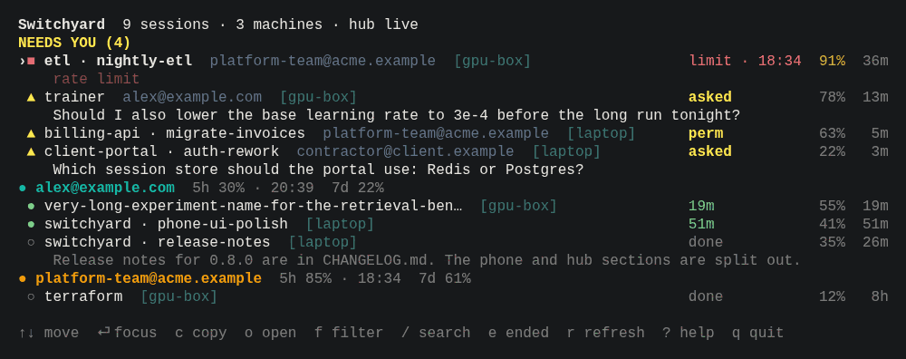

# The board

The board is the hub's view of every session on every machine, grouped by account, with each
account's limits. You can open it in a browser, in the desktop app, in the Android app, in any
terminal, or as a pane inside Claude Code. All of them read the same hub.

## Session states

| State | Meaning | Needs you |
| --- | --- | --- |
| `working` | Claude is running a turn | no |
| `needs_permission` | Claude is waiting on a permission prompt | yes |
| `asked` | Claude asked a question, opened a dialog, or ended its turn with a plain-text question | yes |
| `done` | Idle at the prompt (a new session shows as "new") | no |
| `failed` | The turn stopped with an error: rate limit, login, billing | yes (not for overload or server errors) |
| `ended` | The session ended | no |
| `gone` | The session vanished without ending (crash, reboot) | no |

States come from Claude Code's hooks through `wy hook`; the rules are in
[docs/spec/states.md](../spec/states.md). Question detection uses the tail of Claude's last
message, which is sent to the hub only while `privacy.last_message` is on (the default for your
own hub; see [security.md](security.md)).

## In a browser

The board is served by the hub at its address, for example `http://127.0.0.1:8787` on a
laptop hub or `https://hub.example.ts.net` behind `tailscale serve`.

There are two kinds of sign-in:

- **Owner:** `wy hub owner-link` (on the hub's computer, or
  `docker compose exec hub wy hub owner-link`) prints a one-time link valid for 10 minutes. It
  signs that browser in as the owner for 30 days. The owner can change rules, pair and revoke
  devices, edit the peers matrix and confirm the owner key.
- **Read-only:** a device token or a pairing code (`wy hub pair --kind browser`) signs a
  browser in to read the board; controls that change things are hidden or explain why.

Screens: **Now** (what needs you, account limits), **Sessions** (filter by state, group by
machine), **Accounts** (limits, resets, pace, most room right now), **Machines** (last seen,
backlog, version, reach), **Alerts** (rules, quiet hours, recent notifications), **Analytics**
([usage.md](usage.md)), **Peers** ([peers.md](peers.md)), **Keys** ([peers.md](peers.md)),
**Devices** (owner: paired phones, browsers and machines; rename, revoke, add), **Settings**.

"Most room right now" is a suggestion. Watchyard never switches accounts for you.

## On a phone

- **Android:** the Android app has the same screens plus native notifications and widgets
  ([android.md](android.md)).
- **iPhone, or Android without the app:** install the board as a web app. Run
  `wy phone pair --url https://hub.example.ts.net` on the hub, scan the QR with the camera,
  add the page to the home screen, and turn on notifications in Settings
  ([alerts.md](alerts.md)). iPhone needs iOS 16.4 or newer for notifications.

## In a terminal



```sh
wy status                 # this machine's sessions, from the local outbox (no hub needed)
wy board                  # the interactive board
wy board --once           # one frame and exit; --json prints the view as JSON
wy board connect          # get the read-only board token from the hub (once per machine)
wy open                   # list accounts with their 5-hour use and reset time
wy open work              # open a session as that account (a Warp tab, or this terminal with --here)
```

`wy board` reads from the hub when this machine is connected and has a board token, and from
the local outbox otherwise. While the hub is down it keeps showing this machine's sessions
live and other machines' last known state, greyed.

`wy board connect` needs either the hub on this machine or a **desktop** pairing code: make
one with `wy hub pair --kind desktop` (or on the board, Devices, Add desktop app) and pass it
on stdin with `wy board connect --code-stdin`. The same token lets `wy analytics` read reports.

## Inside Claude Code: the pane

```sh
wy term setup --pane --dry-run
wy term setup --pane
```

This installs the `watchyard-pane` mod from the local marketplace: a side pane with the
board, a band above the prompt when another session needs you, and a status entry. It only
reads; it runs nothing but `wy`. Other terminal pieces:

- `wy term titles on`: tab titles that show the account and state.
- `wy term warp on`: one Warp tab configuration per account (`wy open <label>` opens it).
- `wy ssh user@host`: `ssh` that lets the remote session be focused from the board.
- `wy term status` shows what is on; `wy term off` removes every terminal piece.

Every change is journaled and undone by `wy setup --undo`. Details:
[docs/spec/terminal.md](../spec/terminal.md).

## Claude Code plugin from GitHub

`wy setup` installs the Watchyard plugin from a local marketplace it writes itself, with the
path of your `wy` binary filled in. That is the recommended way.

You can also add this repository as a plugin marketplace and install the plugin from there,
for example to get the `/watchyard:setup` skill before `wy` is installed:

```text
/plugin marketplace add mraj602/watchyard
/plugin install watchyard@watchyard
```

On Claude Code 2.1.275 or later one line does both:
`/plugin install watchyard --marketplace mraj602/watchyard`. From a shell, use
`claude plugin marketplace add mraj602/watchyard` and
`claude plugin install watchyard@watchyard`. Its hooks run `wy` from `PATH` and do nothing
when `wy` is not installed. When you later run `wy setup`, it adopts this plugin instead of
installing a second copy (two copies would record every event twice). The pane mod is only
available through `wy term setup --pane`.
