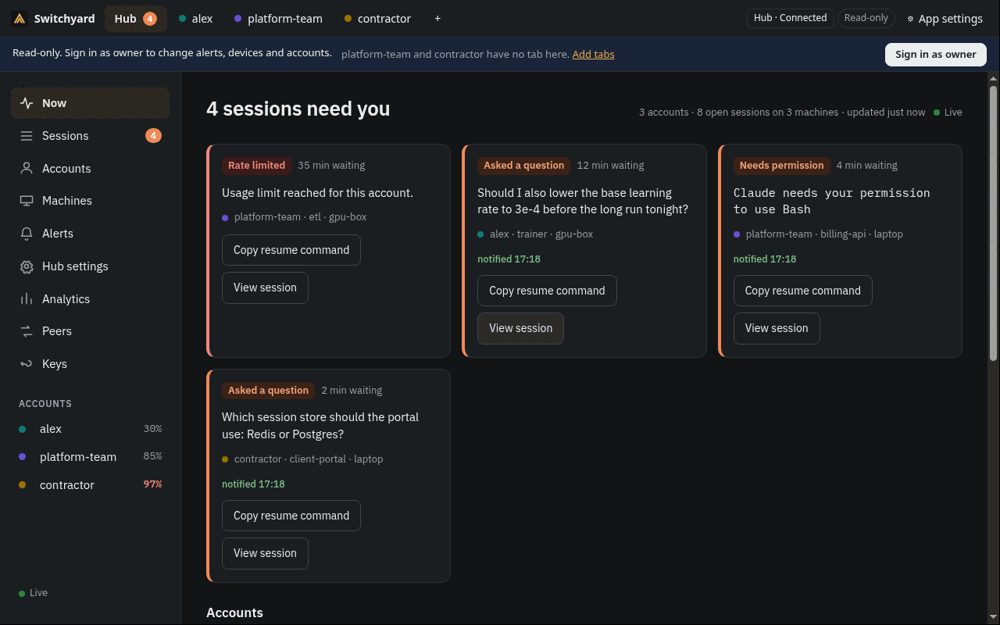
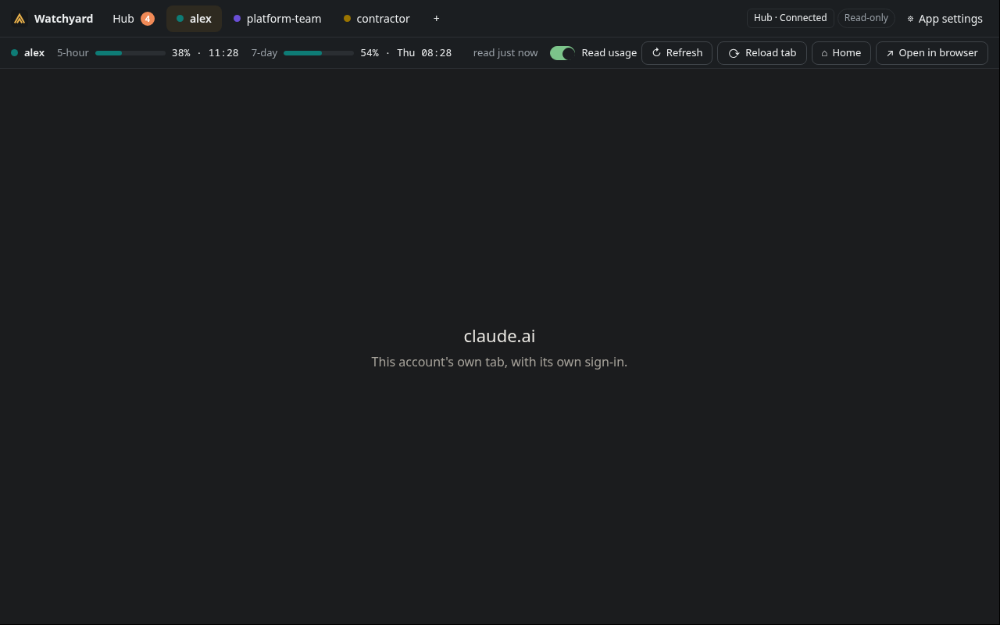

# Desktop app

The desktop app puts every claude.ai account you use in one window, one tab per account, each
with its own sign-in. Under each tab a usage strip shows that account's limits. A **Hub** tab
shows the board, and the app turns hub alerts into OS notifications and a tray badge. It is
optional: `sy` and the hub work without it. The spec is [desktop.md](../spec/desktop.md).





Platforms: Linux (AppImage, deb, rpm), macOS (dmg) and Windows (NSIS installer). Packages are
not code-signed, so macOS and Windows warn on first start (see
[Unsigned builds](#unsigned-builds-on-macos-and-windows)).

## Download

Every `sy` release on [GitHub Releases](https://github.com/mraj602/switchyard/releases)
(tags `vX.Y.Z`) also carries the desktop packages, built from the same commit as the `sy`
archives, plus `SHA256SUMS-desktop`. The app inside has the same version as the tag, and
bundles the `sy` of that release.

The files are named `Switchyard-<version>-<os>-<arch>.<ext>`:

| OS | Package |
| --- | --- |
| Linux | `.AppImage` (runs anywhere: `chmod +x` it, then run it), `.deb`, `.rpm` |
| macOS | `.dmg` |
| Windows | `.exe` (the installer) |

Check a download against the sums, in the folder that holds it:

```sh
sha256sum -c --ignore-missing SHA256SUMS-desktop      # Linux; on macOS: shasum -a 256 -c
```

On Windows, compare `(Get-FileHash <file>).Hash` with the line for that file in
`SHA256SUMS-desktop`. To check where a package was built, use its attestation (see
[Unsigned builds](#unsigned-builds-on-macos-and-windows)). Then install it the usual way for
your OS. The packages are unsigned, so macOS and Windows warn the first time.

## Build from source

You can build it yourself instead. You need Node 22 or later and Go (the package bundles its own `sy`).

```sh
make app-dist                 # packages in app/dist/
```

`make app-dist` builds `sy` for this machine, bundles it and runs electron-builder for this
OS. On Linux without `libcrypt.so.1` (Fedora: `dnf install libxcrypt-compat`) only the
AppImage is built; set `APP_DIST_LINUX="AppImage deb rpm"` to choose targets.

To run from the source tree instead:

```sh
cd app
npm ci                        # downloads the Electron binary
npm start
```

The app looks for `sy` on `PATH` or in `~/.local/bin` (when it is recent enough), else uses
its bundled copy. Without any `sy` the account tabs still work, and the Hub tab says to run
`sy setup` ([install.md](install.md)).

### Unsigned builds on macOS and Windows

Switchyard does not pay for Apple or Microsoft code-signing certificates, so the macOS and
Windows packages are unsigned and the OS warns the first time you open them.

- **macOS:** in Finder, right-click (or Control-click) **Switchyard** in Applications, choose
  **Open**, then **Open** again in the dialog. macOS remembers the choice. On recent macOS,
  if there is no Open button, go to System Settings, Privacy & Security, and click
  **Open Anyway** for Switchyard. From a terminal you can instead remove the quarantine flag
  that the download added:

  ```sh
  xattr -dr com.apple.quarantine /Applications/Switchyard.app
  ```

- **Windows:** when SmartScreen says "Windows protected your PC", click **More info**, then
  **Run anyway**.

Do this only for a package you built yourself or got from the project's GitHub releases. To
check where a release file came from, use its GitHub build attestation:

```sh
gh attestation verify <file> --repo mraj602/switchyard
```

The release workflow builds every desktop package in CI, attests each one and publishes
`SHA256SUMS-desktop`, so `gh attestation verify` works on them, as on the `sy` archives. The
attestation proves the file was built by this repository's release workflow; it is not a code
signature, so the OS warning stays. If you would rather not trust the download, build it
yourself with `make app-dist`.

### Updates

The app has no updater and asks no update server. Settings, About lists this app's version,
sy's and the hub's. When sy or the hub runs a newer release than the app, Settings says
"Update available" with **Open the release page**; when the app is newer, it suggests
`sy update`. Install the new package the same way as the first.

## Account tabs

1. Click **+**, name the tab, and a fresh, isolated session opens on claude.ai.
2. Sign in on claude.ai's own page inside the tab, with your email and the code claude.ai
   sends. Google sign-in does not work in embedded browsers.
3. Every tab stays signed in at the same time; switching tabs never signs anything out.

How sign-in is handled:

- You sign in on Anthropic's own claude.ai page. Switchyard shows no login form of its own.
- Each tab's sign-in lives in its own local Electron session (`persist:tab-<id>`) on this
  computer. It never reaches the hub or any other machine.
- Switchyard never reads, exports or sends cookies or tokens.
- The cookies that keep a tab signed in are encrypted on disk with your operating system's key
  store. If you update from an early build, a tab may ask you to sign in again once.
- A website cannot use a certificate from your computer to identify you: the app offers none.
- Account tabs present a plain Chrome user agent for the real operating system instead of
  Electron's default, because claude.ai's bot protection rejects Electron's. claude.ai sees an
  ordinary Chrome browser; see [claude-ai.md](claude-ai.md#the-browser-identity-of-the-tabs).
- A tab may only navigate to claude.ai and its sign-in pages over `https:`; other links open
  in your system browser.

When the hub knows an account that has no tab here, the Hub tab says so ("claude-6 has no tab
here. Add tabs") and **+** offers a tab for it. If a tab is signed in as a different account
than the one it was made for, its strip says so and offers to use the tab for that account or
to sign out and sign in again.

Use only your own accounts, within the terms of your Claude plan. See [faq.md](faq.md).

## Usage strip and usage reading

Under each tab a strip shows the 5-hour and 7-day windows, per-model weekly windows, reset
times, the reading state and "last read". When the hub knows the account, the numbers come
from the hub; otherwise from the tab's own last read, marked "local".

Reading usage in a tab is **off for each account until you accept a warning**. Until then the
strip says **Usage reading not enabled** with a **Review** button. The first time a signed-in
tab could read, the app asks:

> **Read usage for this account?**
> Every 5 minutes, Switchyard runs a small script inside this tab that reads the same numbers
> claude.ai shows under Settings → Usage. It reads numbers only: no chats, no cookies. They go
> to your own hub.
> This uses an internal claude.ai endpoint, not a public API. It may stop working, and
> automated access may not be allowed by Anthropic's consumer terms, so it could get this
> account flagged. Switchyard is unofficial and not affiliated with Anthropic.
> You can turn reading off for this account at any time in its usage bar or in Settings.
> **[Read usage for this account]  [Not now]**

What accepting does:

- Every 5 minutes (and shortly after the tab loads), the app calls claude.ai's internal
  endpoints `/api/organizations`, `/api/organizations/{uuid}/usage` and `/api/account` from
  inside the signed-in tab, with that tab's own session.
- The numbers are handed to `sy outbox append` and sent to your hub as `web_usage` records.
  A tab with "send to hub" off only updates its own strip.
- Errors back off (5 minutes up to an hour). A 401 (signed out), 403 or 429 (rate limited)
  stops reading for that account until you click **Resume**.

You decide whether to enable it. **Not now** leaves the tab working normally. The tray's
**Pause all reading** turns it off for every tab. Where else limits come from is in
[usage.md](usage.md).

## Hub tab and pairing

The Hub tab shows the board, signed in with a read-only desktop token.

1. Run `sy setup` on this computer and connect it to your hub (or run the hub here).
2. Open the Hub tab. If this computer can reach the hub's admin side (a local hub, or one
   added with `sy machine add`), pairing is one click.
3. Otherwise make a desktop code on the board (More, Devices, Add desktop app) or on the hub
   with `sy hub pair --kind desktop`, and type it into the app.

The token is stored encrypted with the OS keyring (`safeStorage`) and never enters a web
page; the app signs the Hub view in with a read-only cookie. On Linux without a keyring the
token falls back to basic storage, and Settings warns.

**Plain http.** The app accepts a typed `http://` address only for this computer and for a
`.ts.net` name. For a hub on your own network (`http://192.168.1.5:8787`, `http://nas.local`, a
single name like `http://nas`, a Tailscale IP) tick **Allow plain http** under the address first.
Public names are never accepted over http. With that, the desktop token and
everything else the app exchanges with the hub then cross your network unencrypted: anyone on
that network can read them, and with the token, read your board. The app says so in the Hub
tab and in Settings for as long as the address is http. Loopback addresses
(`http://127.0.0.1`, `localhost`) are not warned about. To fix it, give the hub an https
address, for example with `tailscale serve` or a reverse proxy (see [install.md](install.md#3b-hub-on-a-server)).

**Self-signed https.** If the hub's https certificate is self-signed (or signed by an
authority this computer does not trust), the app does not just accept it. It shows the
certificate's SHA-256 fingerprint and asks you to compare it with the real one. On the
computer that serves https for the hub (the reverse proxy, not necessarily the hub itself),
run:

```sh
openssl s_client -connect hub.lan:8443 -servername hub.lan </dev/null 2>/dev/null \
  | openssl x509 -noout -fingerprint -sha256
```

(Leave out `-servername` for an IP address.) If every pair matches, click **The fingerprints
match: trust it**. The app pins that certificate for this hub: from then on it accepts exactly
that certificate for it, in its own requests and in the Hub tab, and nothing else. `sy` and the
hub cannot print this fingerprint, because the hub itself speaks plain http behind the proxy
and never sees the certificate.

If the hub later presents another certificate, the app says **The hub's certificate changed**
and sends nothing to it, not even the token. If you replaced the certificate yourself (a
renewal, a new proxy), compare the new fingerprint the same way and trust it. If you did not,
someone may be intercepting the connection: do not trust it. Unpairing and forgetting the hub
removes the pin.

**Owner sign-in.** Changing rules, devices, peers or keys needs an owner session. Settings,
Hub, **Sign in as owner** asks `sy desktop owner-link` for a one-time link and opens it in
the Hub tab. It lasts 30 days. Keys and Peers are the board's own pages, shown in the Hub tab
(see [peers.md](peers.md)).

## Settings

- **Account tabs:** name, the account's label and colour (editable with an owner session),
  the reading switch, the send-to-hub switch, the warning status, Remove.
- **This computer's Claude Code folders:** the output of `sy account list` with the sharing
  switches. Adding an account or logging in needs a terminal, so the app shows the
  `sy account add` and `sy account login` commands to copy. See [accounts.md](accounts.md).
- **Hub:** address, connection, version, owner yes or no, pairing, the certificate state of
  an https hub (verified, pinned, or not trusted), an encryption warning for plain http, and
  for a local hub the service state with Start and Stop.
- **About:** the versions of this app, sy and the hub, and the update notice.
- **Notifications** and **Background:** run at login, start hidden, keep running when the
  window is closed, tray.
- **Hub settings:** links to the board's Machines, Alerts and rules, Devices, Phone pairing
  and Settings pages.

## Notifications and tray

When the hub fires an alert, the app shows an OS notification: the account and project in
the title, the trigger ("asked a question", "needs permission", "5-hour at 82 %") and the
question, cut short. Clicking it opens that session in the Hub tab. Desktop notifications have
no Snooze or Seen buttons (the desktop token is read-only); use the board for those.

The tray icon gets a dot when a session needs you. Its menu lists up to five such sessions,
**Refresh usage**, **Pause all reading** and **Quit**. On a desktop with no tray (GNOME
without the AppIndicator extension), closing the window quits unless "Keep running" is on.

## Shortcuts

| Keys | Action |
| --- | --- |
| Ctrl/Cmd+0 | Hub tab |
| Ctrl/Cmd+1 to 9 | The first nine account tabs |
| Ctrl/Cmd+R | Refresh usage |
| Ctrl/Cmd+Q | Quit |

## Running in the background

Settings, Background, **Run at login** starts the app hidden at login (`--background`): no
window, but usage reading and notifications continue. On Linux this writes
`~/.config/autostart/switchyard-desktop.desktop`; on macOS and Windows it uses the OS login
items. A second launch shows the existing window.

## Where its data lives

| OS | Folder |
| --- | --- |
| Linux | `~/.config/switchyard-desktop` |
| macOS | `~/Library/Application Support/switchyard-desktop` |
| Windows | `%APPDATA%\switchyard-desktop` |

It holds `app-state.json` (tabs and settings, mode 0600), `hub-token.bin` (the encrypted
desktop token) and Chromium's own folders, including each tab's sign-in. Deleting a tab
deletes its session. Uninstalling the app does not remove this folder; delete it to remove
every sign-in (see [uninstall.md](uninstall.md)).

## Security baseline

- Every window and view runs with context isolation and the Chromium sandbox, without Node
  integration. Only the app's own shell has a preload, exposing a fixed list of functions;
  each IPC call checks its sender and arguments.
- The shell is served with a strict content security policy and loads nothing from the
  network.
- Permissions (camera, notifications from pages and so on) are denied by default.
- An account tab can only show claude.ai and the pages that sign-in and billing need, and
  frames inside it are limited to the same list (claude.ai, Anthropic, Cloudflare's
  challenge, Stripe checkout, Google sign-in). Any other frame is blocked. The Hub tab can only
  show your hub. See [claude-ai.md](claude-ai.md).
- Certificate errors are never overridden, except for a hub certificate you pinned yourself
  (above), and only in the Hub tab and the app's own hub requests.
- `sy` is run without a shell, from an allow-list of commands; secrets go on stdin, never on
  the command line. Nothing the hub sends can make the app run anything.
- Packaged builds disable `ELECTRON_RUN_AS_NODE`, `NODE_OPTIONS` and `--inspect`, and check
  the integrity of the app archive.

More in [security.md](security.md) and [desktop.md C2](../spec/desktop.md#c2-security-baseline).
