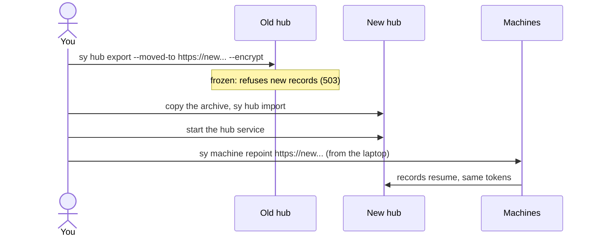

# Backups, upgrades and moving the hub

`sy paths` prints the three folders this guide refers to: **config** (`config.toml`), **state**
(machine id, device token, outbox, keys, logs, setup backups) and **data** (the hub database,
only on the hub machine). Details: [paths.md](../spec/paths.md).

## Backups

### The hub

The hub database is the long-term record. Make a consistent copy while the hub runs:

```sh
sy hub backup                          # <data>/backups/hub-<UTC time>.db
sy hub backup --to /path/to/hub.db     # or a file of your choice
```

With Docker (from `deploy/`):

```sh
docker compose exec hub sy hub backup  # lands in the hub-data volume under /data/backups
```

Then copy the backup off the machine with your usual tool, or back up the whole Docker volume
`switchyard_hub-data`. A cron job running `sy hub backup` once a day is enough for most setups.

Also keep, on the hub machine:

- `<state>/hub_sign.key`, the hub signing key. It is not in `hub.db`. Without it, a restored hub
  makes a new key, and every device that pinned the old one must re-pin
  (`sy agent enable --repin-hub`) and phones must pair again.
- `<state>/pair_pepper`. Owner sessions and pairing codes are hashed with it; without it every
  owner sign-in ends and you sign in again with `sy hub owner-link`.
- `<state>/pull/`, if the hub pulls servers over SSH.

`sy hub export` (below) packs all of these into one archive and is the simplest full backup when
you can afford to freeze the hub; use `--no-freeze` to copy without freezing.

Backups hold project names, emails, session snippets, token hashes and private keys. Store them
encrypted.

### Each machine

| Keep | Why |
| --- | --- |
| The recovery code of the owner key, on paper, offline | Rebuilds `owner.sealed` with `sy keys recover` |
| `<state>/keys/owner.sealed` (owner machine only) | Saves you typing the recovery code on a restored laptop |
| `config.toml` | Your labels, colours and settings; `sy setup` can recreate the rest |
| Your own copies of `settings.json` and `CLAUDE.md` | `sy setup` keeps its own backups under `<state>/backup/`, but those live on the same disk |

Never copy `.credentials.json`, a Keychain item or `sessions/*.key` from a Claude folder into a
backup. Log in again with `claude auth login` instead.

Losing the state folder loses unsent records and makes the machine look new to the hub; reconnect
it with `sy connect` ([install.md](install.md)).

### Restore the hub

1. Stop the hub: `systemctl --user stop switchyard-hub` (or `docker compose stop hub`).
2. Move the current `<data>/hub.db` aside, and remove `hub.db-wal` and `hub.db-shm` next to it.
3. Copy the backup to `<data>/hub.db`.
4. Make sure `<state>/hub_sign.key` and `<state>/pair_pepper` are the ones from the same hub.
5. Start the hub again and check `sy doctor` and the board.

Records sent while the hub was down wait in each machine's outbox and arrive when it is back.
Records the hub accepted after the backup was taken are lost unless the machines still have
them.

## Upgrades

There are no published releases yet, so upgrades are from source.

### `sy` on a machine

```sh
cd switchyard
git pull
make build
install -m 0755 dist/sy ~/.local/bin/sy
sy version
sy doctor
```

Running sessions pick up the new binary at their next hook; nothing needs restarting. If the hub
runs on this machine as a user service, restart it: `systemctl --user restart switchyard-hub`
(macOS: the hub's LaunchAgent restarts when you log out and in, or run `sy desktop hub stop` and
`sy desktop hub start`).

The hub migrates its database schema at start, after copying the database file, so an upgrade
needs no manual step. A machine on an older `sy` keeps working with a newer hub; `sy doctor` says
when it should be updated.

### The hub in Docker

```sh
cd switchyard && git pull
cd deploy && docker compose up -d --build     # add -f docker-compose.tailscale.yml if you use it
docker compose ps                             # healthy within about 30 s
```

See [deploy/README.md](../../deploy/README.md).

### `sy update` (after the first release)

Once releases are published on GitHub, `sy` updates itself from them, verifying the checksum:

```sh
sy update --check            # what is installed and what is latest
sy update                    # update this machine (asks first; --yes to skip)
sy update --machines all     # also every machine added with sy machine add
sy update --rollback         # swap the previous binary back
sy update --version 0.2.0    # a specific version
```

Offline machines can install an archive you copied there:
`sy update --from-file sy_<ver>_linux_amd64.tar.gz --sums-file SHA256SUMS`.

### The desktop app

Rebuild the package with `make app-dist` and install the new package over the old one
([desktop.md](desktop.md)). Account tabs, sign-ins and settings live in the app's user data
folder and are kept.

### The Android app

Install the new APK over the old one. It must be signed with **the same key**; Android refuses
an update signed by another key, and you would have to uninstall (and pair again). Pairing and
settings are kept. Once releases are published, the app offers updates itself
([android.md](android.md)).

## Moving the hub

To move the hub to another computer (for example from your laptop to an always-on server):



1. On the old hub, freeze it and write an encrypted archive:

   ```sh
   sy hub export --moved-to https://hub.example.ts.net --encrypt --out ~/hub.syx
   ```

   From now on it answers 503 to new records. Machines keep them in their outbox.
2. Copy `~/hub.syx` to the new machine (for example with `scp`). It holds every token hash and
   key: treat it like a password.
3. On the new machine, with `sy` installed and no hub running yet:

   ```sh
   sy hub import ~/hub.syx --public-url https://hub.example.ts.net
   ```

4. Start the hub there as a service ([install.md](install.md)), and put HTTPS in front of it.
5. Point the machines at it. From the laptop, for every machine added with `sy machine add`:

   ```sh
   sy machine repoint https://hub.example.ts.net
   ```

   On any other machine, and on the laptop itself:

   ```sh
   sy connect https://hub.example.ts.net --keep-token
   ```

6. Check `sy doctor` on each machine and the board at the new address. Delete `~/hub.syx`.

Tokens keep working. Phones keep working if the public URL stayed the same; otherwise pair them
again. `sy doctor` on a machine whose hub is frozen prints the exact `sy connect ... --keep-token`
line. To call the move off, run `sy hub unfreeze` on the old hub.

With Docker on either side, see section E of [deploy/README.md](../../deploy/README.md).

## Pruning

The hub keeps raw records by default (roughly half a gigabyte a year at heavy use). To keep less:

```sh
sy hub prune --older-than 90d --dry-run    # count first
sy hub prune --older-than 90d
sy hub prune --before 2026-01-01
```

This deletes raw records and fine-grained rows older than the cut-off. Take a backup first.
